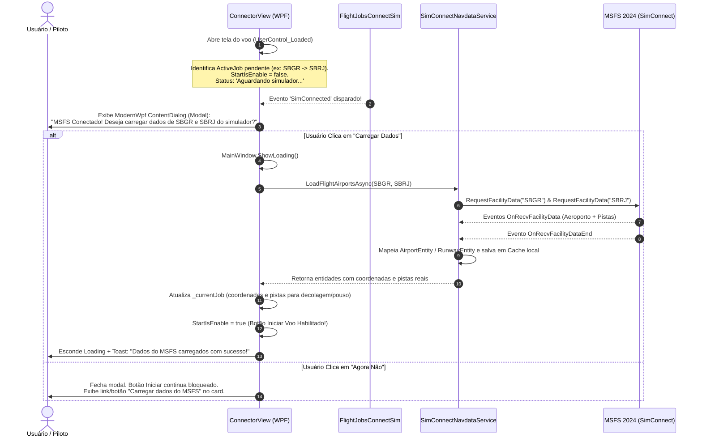

# 🛫 Plano de Migração Definitivo: Dados de Aeroportos e Pistas via SimConnect no MSFS 2024

---

## 📌 Resumo das Decisões de Arquitetura

Com base nas definições alinhadas:
1. **Sem contingência SQLite:** O arquivo legado [`navdata.sqlite`](file:///c:/DotNetProjects/FlightJobsDesktop/FlightJobs.Domain.Navdata/navdata.sqlite) (46 MB) e a classe [`SqLiteDbContext`](file:///c:/DotNetProjects/FlightJobsDesktop/FlightJobs.Domain.Navdata/SqLiteDbContext.cs) serão **completamente eliminados**. A aplicação consumirá exclusivamente os dados reais e atualizados do simulador.
2. **Estratégia do SDK / Wrapper Próprio:**
   - Utilizaremos as DLLs oficiais do **MSFS 2024 SDK** identificadas em `C:\MSFS 2024 SDK\SimConnect SDK\lib\managed\Microsoft.FlightSimulator.SimConnect.dll` e `SimConnect.dll`, copiando-as para a pasta do projeto (`FlightJobs.Connect.MSFS.SDK/lib/SimConnect/`), garantindo portabilidade para qualquer desenvolvedor sem depender de caminhos absolutos no sistema.
   - Construiremos um **wrapper próprio gerenciado** (`SimConnectNavdataService` / `IAirportDataProvider`) em C# com suporte a chamadas assíncronas (`Task<AirportEntity>`), mapeamento de structs, tratamento de timeouts e cache local leve em JSON.
3. **Experiência do Usuário (Modal ModernWpf):**
   - Ao detectar conexão bem-sucedida via SimConnect e havendo um voo pendente, a aplicação exibirá um **`ContentDialog` modal** estilizado conforme o Design System do [`App.xaml`](file:///c:/DotNetProjects/FlightJobsDesktop/FlightJobs.Presentation/App.xaml).
   - O botão **Start Job** permanecerá desabilitado até a carga bem-sucedida dos dados do MSFS.
   - Se o usuário fechar o modal, um botão de ação rápida ficará disponível no card do voo para recarregar sob demanda.

---

## 🔄 1. Fluxo do Voo e Interação do Usuário (UX/UI)



---

## 🏗️ 2. Arquitetura das Novas Camadas

```mermaid
graph TD
    subgraph UI ["FlightJobs.Presentation (MVVM)"]
        CV[ConnectorView / ViewModel]
        CD[ContentDialog Modal: 'Carregar Dados do Voo']
        PV[PracticeView]
    end

    subgraph Domain ["FlightJobs.Domain.Navdata"]
        INav[IAirportDataProvider]
        Cache[LocalNavdataCache (JSON Leve)]
        RHelper[RunwayHelper]
        AEnt[AirportEntity]
        REnt[RunwayEntity]
    end

    subgraph ConnectSDK ["FlightJobs.Connect.MSFS.SDK"]
        FConn[FlightJobsConnectSim]
        SCNav[SimConnectNavdataService]
        SimDLL["Microsoft.FlightSimulator.SimConnect.dll (MSFS 2024 SDK)"]
    end

    CV --> CD
    CV --> INav
    PV --> INav
    RHelper --> AEnt
    RHelper --> REnt
    INav --> SCNav
    SCNav --> Cache
    SCNav --> SimDLL
    FConn -.->|Dispara SimConnected| CV
```

### 2.1 Interface de Contrato (`IAirportDataProvider`)
Localizada em `FlightJobs.Domain.Navdata/Interface/IAirportDataProvider.cs`:

```csharp
public interface IAirportDataProvider
{
    Task<AirportEntity> GetAirportAsync(string icao);
    Task<IList<RunwayEntity>> GetRunwaysAsync(string icao);
    Task<bool> LoadFlightDataAsync(string departureIcao, string arrivalIcao, string alternativeIcao = null);
    AirportEntity GetCachedAirport(string icao);
}
```

### 2.2 Wrapper Próprio Gerenciado (`SimConnectNavdataService`)
Localizado em `FlightJobs.Connect.MSFS.SDK`:
- Utiliza a instância do SimConnect para registrar a definição hierárquica:
  - `"OPEN AIRPORT"`: `ICAO`, `NAME`, `LATITUDE`, `LONGITUDE`, `ALTITUDE`, `MAGVAR`, `N_RUNWAYS`
  - `"OPEN RUNWAY"`: `NAME`, `LATITUDE`, `LONGITUDE`, `ALTITUDE`, `HEADING`, `LENGTH`, `WIDTH`, `PRIMARY_DISPLACED_THRESHOLD`, `SECONDARY_DISPLACED_THRESHOLD`, `SURFACE`
  - `"CLOSE RUNWAY"`
  - `"CLOSE AIRPORT"`
- Converte a recepção assíncrona baseada em eventos do SimConnect para o padrão moderno do .NET `Task<AirportEntity>` usando `TaskCompletionSource<AirportEntity>`.
- Possui controle de timeout (ex: 6 segundos): caso o simulador demore ou o ICAO não exista no MSFS, cancela suavemente e informa o usuário.

### 2.3 Cache Local em JSON (`NavdataCacheService`)
- Salva os aeroportos consultados em um arquivo JSON leve em `%LocalAppData%\FlightJobsDesktop\Cache\AirportsCache.json`.
- Evita que o sistema precise reconsultar o SimConnect para um aeroporto já carregado durante a mesma sessão ou em voos frequentes.

---

## 📐 3. Mapeamento de Pistas e Cálculos de Voo

O FlightJobs depende das coordenadas exatas dos extremos de pista para calcular desvios de linha de centro e toques de cabeceira em [`RunwayHelper`](file:///c:/DotNetProjects/FlightJobsDesktop/FlightJobs.Domain.Navdata/Helpers/RunwayHelper.cs):

1. **Identificação da Pista (`RunwayHelper.GetRunway`):**
   - Compara a proa verdadeira da aeronave com a proa da pista (`HeadingTrue`).
   - Avalia a menor distância ao centro da pista.
2. **Desvio de Linha Central na Decolagem e Pouso (`GetCenterLineDistanceSigned`):**
   - Utiliza as coordenadas `PrimaryLaty/PrimaryLonx` e `SecondaryLaty/SecondaryLonx`.
   - Se o SimConnect retornar o ponto central e o comprimento/proa da pista, o serviço calcula automaticamente as coordenadas geodésicas das duas cabeceiras através de fórmulas de rumo direto (`GeoCoordinate` / projeção esférica), garantindo 100% de compatibilidade com os algoritmos existentes.
3. **Distância de Toque à Cabeceira (`GetTouchdownThresholdDistance`):**
   - Aplica o `OffsetThreshold` (cabeceira deslocada) informado pelo MSFS.

---

## 🗂️ 4. Impacto e Limpeza Arquitetural

| Arquivo / Componente | Modificação |
| :--- | :--- |
| `FlightJobs.Domain.Navdata/navdata.sqlite` | **Deletar arquivo físico** (economia de 46 MB) e remover do `.csproj`. |
| `FlightJobs.Domain.Navdata/SqLiteDbContext.cs` | **Remover classe** e dependências do `System.Data.SQLite`. |
| `FlightJobs.Domain.Navdata/Interface/ISqLiteDbContext.cs` | **Substituir por** `IAirportDataProvider.cs`. |
| `FlightJobs.Domain.Navdata/Utils/GeoCalculationsUtil.cs` | Remover instância estática de `SqLiteDbContext` e método morto `CalcDistance(string, string)`. |
| `FlightJobs.Domain.Navdata/Helpers/RunwayHelper.cs` | Atualizar métodos para consumir `AirportEntity` carregado da nova interface. |
| `FlightJobs.Connect.MSFS.SDK/lib/SimConnect/` | Criar pasta e adicionar `Microsoft.FlightSimulator.SimConnect.dll` e `SimConnect.dll` do SDK 2024. |
| `FlightJobs.Connect.MSFS.SDK/SimConnectNavdataService.cs` | Criar o novo serviço de Facility Data. |
| `FlightJobs.Connect.MSFS.SDK/FlightJobsConnectSim.cs` | Adicionar evento `SimConnected` e expor o serviço de navdata. |
| `FlightJobs.Presentation/Views/Home/ConnectorView.xaml.cs` | Implementar modal `ContentDialog`, controle de `StartIsEnable` e carga do voo. |
| `FlightJobs.Presentation/Views/Home/PracticeView.xaml.cs` | Atualizar busca de ICAO para utilizar o novo provedor de dados. |
| `FlightJobs.Presentation/App.xaml.cs` | Registrar `IAirportDataProvider` no container de injeção de dependência. |

---

## 🎨 5. Especificação do Modal (`ContentDialog`)

Seguindo as regras do **Design System do Cockpit** (`antigravityrules.md` e `App.xaml`):
- **Controle:** `ModernWpf.Controls.ContentDialog`
- **Fundo / Estilo:** Estilo escuro nativo do ModernWpf integrado com `BackgroundSecondary` (`#1f2937`) e borda suave `BackgroundTertiary`.
- **Título:** `"Conexão com MSFS Estabelecida"`
- **Mensagem:** 
  > *"O simulador Microsoft Flight Simulator foi conectado com sucesso!*\
  > *Foi identificado o voo pendente: **{DepartureICAO} ➔ {ArrivalICAO}**{AlternativeText}.*\
  > *Deseja carregar os dados de aeroporto e pista atualizados diretamente do MSFS para liberar o início do voo?"*
- **PrimaryButton:** `"Carregar Dados do MSFS"` (estilo `ButtonPrimaryStyle`)
- **CloseButton:** `"Agora Não"` (estilo `ButtonGhostStyle`)
- **Comportamento pós-fechamento:** Se fechado com "Agora Não", o botão `Start Job` exibe um estado bloqueado e um botão com ícone de nuvem/download aparece ao lado: `"Importar Dados do Simulador"`.

---

## 📋 6. Etapas de Execução do Projeto


### Detalhamento das Tarefas:

#### Etapa 1: Atualização dos Binários do SDK
1. Criar pasta `FlightJobs.Connect.MSFS.SDK/lib/SimConnect/`.
2. Copiar `Microsoft.FlightSimulator.SimConnect.dll` e `SimConnect.dll` de `C:\MSFS 2024 SDK\SimConnect SDK\lib\`.
3. Atualizar a referência em `FlightJobs.Connect.MSFS.SDK.csproj` e configurar cópia de saída para `SimConnect.dll`.

#### Etapa 2: Construção do Wrapper Próprio de Facility Data
1. Criar structs marshalled para resposta de aeroporto e pistas (`SIMCONNECT_FACILITY_DATA_AIRPORT`, `SIMCONNECT_FACILITY_DATA_RUNWAY`).
2. Implementar `SimConnectNavdataService` gerenciando os IDs de definição e callbacks `OnRecvFacilityData`.
3. Implementar controle assíncrono com `TaskCompletionSource` e timeout de segurança.
4. Adicionar camada de cache JSON local para persistência rápida de aeroportos consultados.

#### Etapa 3: Remoção do SQLite
1. Excluir o arquivo físico `navdata.sqlite` e remover referências do `.csproj`.
2. Excluir `SqLiteDbContext.cs` e `ISqLiteDbContext.cs`.
3. Criar `IAirportDataProvider.cs` em `FlightJobs.Domain.Navdata/Interface/`.
4. Limpar `GeoCalculationsUtil.cs` removendo referências ao banco.

#### Etapa 4: Modal e Fluxo de Voo no ConnectorView
1. Disparar evento `SimConnected` quando a conexão do SimConnect for ativada em `FlightJobsConnectSim.cs`.
2. Em `ConnectorView.xaml.cs`:
   - Configurar `_currentJob.StartIsEnable = false` ao carregar o job ativo se os dados do MSFS ainda não foram importados.
   - Tratar o evento `SimConnected` na UI Thread via `Dispatcher.Invoke()`.
   - Exibir o modal `ContentDialog`.
   - Ao confirmar, chamar `MainWindow.ShowLoading()`, carregar partida e chegada via `SimConnectNavdataService`, atualizar coordenadas e pistas no `_currentJob` e habilitar `StartIsEnable = true`.

#### Etapa 5: Ajustes de RunwayHelper e PracticeView
1. Adaptar `RunwayHelper` para usar as entidades carregadas sem acoplamento a banco de dados.
2. Atualizar `PracticeView` para buscar o ICAO digitado via `IAirportDataProvider`.
3. Atualizar registro do container em `App.xaml.cs`.

#### Etapa 6: Compilação e Verificação
1. Compilar toda a solução em modo `x64` e `Release`/`Debug`.
2. Verificar ausência de avisos ou referências quebradas.
3. Testar a experiência visual e a estabilidade.
